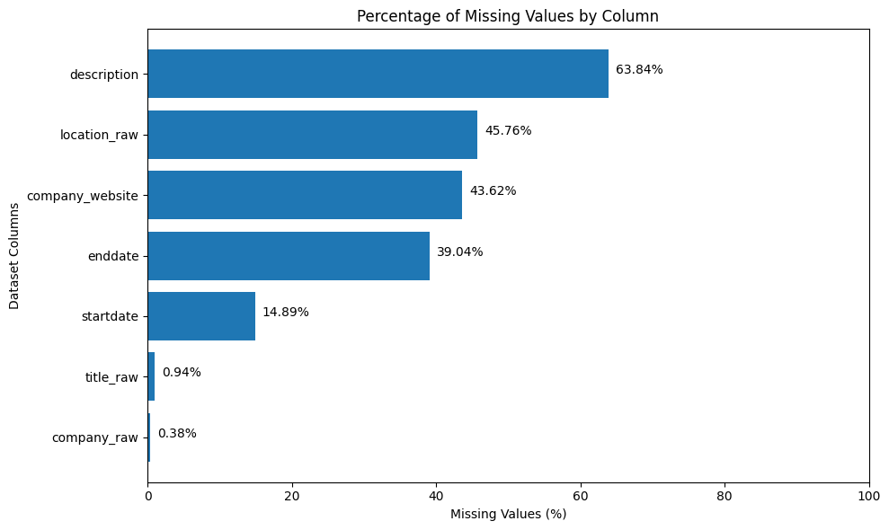
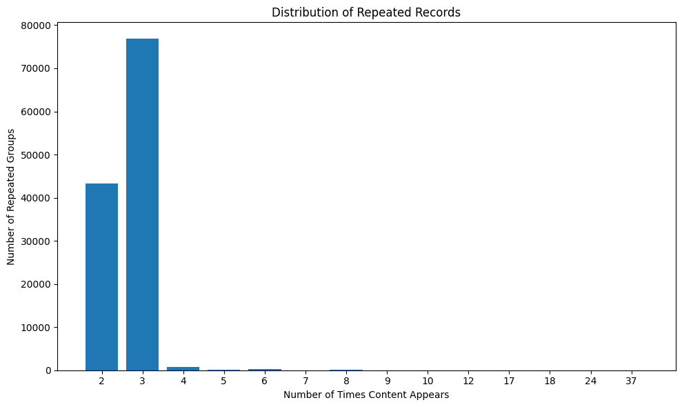
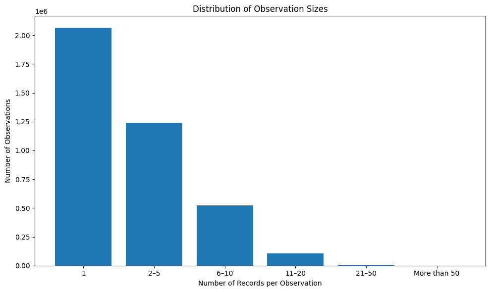

# Technical Design: Position Coalescing

## 1. Understanding the Problem

The goal of this task is to take repeated employment profile snapshots and turn them into one consistent history of a person's positions. The same job can appear with different titles, company names or dates, and a job disappearing from a snapshot does not necessarily mean it has ended.

The pipeline needs to give each position a stable ID, keep its history across snapshots, and avoid using future information when processing earlier ones. It also needs to handle bad snapshots and process about 11.5 million rows within the given resource limits.

## 2. Exploring the Data

I started by looking at how the data was organised. I looked into the missing values, repeated records, snapshot sizes and how records changed across observations. The dataset has 32 files and 11,480,179 rows. These cover 3,941,416 snapshots and 150,000 users. 145,309 users have more than one snapshot.

One difference I found was the URL column name. The brief calls the URL column `company_linkedin_url`, while the dataset uses `company_website`. The pipeline accepts both.

Some fields were missing much more often than others. Descriptions were missing in 63.84% of records, locations in 45.76%, URLs in 43.62%, end dates in 39.04% and start dates in 14.89%. Company and title were rarely missing, at 0.38% and 0.94%.

This helped me understand which fields I could depend on when matching records. Company names and titles were available in almost every record, while URLs could provide extra confirmation when present. Descriptions and locations were less reliable because they were missing quite often.

I also checked how many exact duplicate records existed. There were 121,556 groups of exact copies, adding up to 203,206 extra rows. These duplicates appeared across 75,091 observations from 56,390 users.

Most repeated records appeared two or three times. A few appeared more often, but those cases were much less common.  I decided to remove exact duplicates within each snapshot before matching, so the same job wouldn't be treated as multiple positions.

I also looked at how many records each snapshot contained. The sizes varied quite a lot. Half of the observations contained only one record, while the largest had 370. There were 189 observations with more than 50 records.

One user had 660 different record versions across 150 observations. This was one reason I decided to compare each new record against the user's full position history instead of only looking at the most recent snapshot.

Another thing I wanted to understand was how company names, titles and start dates changed across snapshots.

I found 493,562 company-title combinations that appeared more than once for the same user. Out of these, 16,633 had different start dates.

This showed that matching only by company and title would not be enough. Two records could have the same company and title but still represent different positions.

## 3. Data Cleaning and Preparation

 handled the initial data cleaning in DuckDB, in `src/prepare.py`.

The main goal was to make the data more consistent before matching records, without losing the original values needed in the final output.

Here is what I changed:

- **Missing values:** I converted placeholders such as `null`, `none`, `n/a`, `unknown`, `not applicable` and their equivalents in other languages into actual missing values. I also treated text containing no letters or numbers as missing.
- **Descriptions:** I removed leftover scraping text such as `Show less` and `See more`.
- **URLs:** I removed URL schemes, query strings and trailing slashes. I also standardised different host formats. All URLs in the dataset were LinkedIn company, school or showcase pages.
- **Company names:** I standardised company names for matching. This included handling accents, punctuation and legal endings such as `Inc` and `Ltd`.
- **Dates in location fields:** I found 146 records where dates, such as Feb 2023, had been placed in the location column. I recovered those dates.
- **Text dates:** I also parsed dates that were stored as text.

### Removing bad snapshots

I needed a consistent way to identify snapshots that contained invalid data.

I marked a snapshot as invalid if any of its records had:

- An end date earlier than its start date.
- A date before 1940.
- A date more than 366 days after the observation date.

I also removed snapshots where none of the records had a usable company name, URL or title.

| Reason                                        | Snapshots                            |
| --------------------------------------------- | ------------------------------------ |
| No usable company, URL or title               | 6,636                                |
| End date before start date                    | 2,396                                |
| Date before 1940                              | 651                                  |
| Date more than 366 days after the observation | 217                                  |
| **Total dropped (reasons overlap)**     | **9,890 of 3,941,416 (0.25%)** |

I applied these checks to the whole snapshot rather than removing only the individual record with the problem. This is because the brief defines invalid data at the `(user_id, observed_ts)` level.

I also looked more closely at the 1940 cut-off before keeping it. There were no dates between 1926 and 1939. Most of the earlier dates looked like placeholders, such as `1900-01-01`, or years that appeared to come from the Iranian calendar.

Because of this gap, any cut-off between 1926 and 1939 would have removed the same 651 snapshots. Moving the cut-off later would also risk removing real employment history from the 1940s.

I checked what would happen to the jobs in the rejected snapshots. Out of the other jobs in those snapshots, 59 appeared in other snapshots that were kept, 4 could not be found anywhere else, and 19 belonged to users who had no kept snapshots.

This means around 23 jobs could be lost because of this decision.

### Collapsing duplicates within a snapshot

Some snapshots contained multiple copies of what looked like the same job. I treated records as duplicates when they had the same company (or the same URL if the company name was missing), title and start date.

I left the end date out of the matching key because I found around 9,500 groups with conflicting end dates. Including it would have caused copies of the same job to be treated as different positions.

When the start date was missing, I included the end date in the key instead.

When I found multiple copies of the same position, I used the following order to choose which one to keep:

1. The record with the earliest end date. I preferred a dated record over one marked as ongoing.
2. If the end dates were tied, I kept the more complete record.
3. If they were still tied, I kept the record that appeared higher on the profile.

I didn't want to make this decision without checking whether it actually worked. So I compared the selected records with nearby snapshots where the same job appeared only once.

Choosing the earliest end date agreed with the earlier snapshot 64.1% of the time and the later snapshot 60.9% of the time.

I also tested choosing the most complete record first. That gave 38.0% agreement with the earlier snapshot and 38.6% with the later one.

A common issue was a year-only date appearing as January in one copy and December in another. In nearby snapshots, January was usually the date shown.

For records where one copy had an end date and another was marked as ongoing, both choices performed about the same.

I used the results from `checks/end_date_check.py` to make this decision. It is still only a way to choose between conflicting records, not a guarantee that the selected date is correct.

## 4. Matching: Approaches and Decisions

After cleaning the data, around 11.2 million records were reduced to about 1.58 million distinct versions.

The next step was figuring out which versions belonged to the same position and which ones should be treated as new positions.

### Approaches I considered

| Approach                                        | What I found                                                                                                                                                                | Decision            |
| ----------------------------------------------- | --------------------------------------------------------------------------------------------------------------------------------------------------------------------------- | ------------------- |
| Exact match using company, title and start date | Misses company renames, abbreviations and corrected dates                                                                                                                   | Rejected            |
| Weighted score                                  | I tried giving each field a weight, but without labelled data, I couldn't justify the weights or the score needed for a match. It also struggled with chnages in seniority. | Built, then removed |
| Explicit rules                                  | Each match is based on a clear condition that I can test with examples                                                                                                      | Chosen              |

I initially built a weighted scoring approach, but I wasn't comfortable choosing weights without having labelled examples to support them. A score could say that two records were similar without giving me a clear reason why they should belong to the same position.

I decided to use explicit rules instead. This made it easier to understand why two records were matched and to test each condition separately.

### Matching rules

I compare the company, title and dates separately, then use the results together to decide whether two records belong to the same position.

**Dates**

The start date must either match a date already seen for that position or be within 366 days of its first start date.
I use the first start date as the reference instead of continuously comparing against the latest one. This prevents small date changes from slowly moving the position's start date further and further over time.
I also make sure that positions with no overlapping employment periods are not matched.

**Company**

A company is considered a match if the records share a URL or have the same normalised company name.
I also allow company names that are at least 85% similar or where one name is contained in the other.
For acronyms, such as `EY` and `Ernst Young`, I only allow a match when at least one of the records does not have a URL.

**Title**

I expand common abbreviations before comparing titles. For example, `mle` becomes `machine learning engineer`, and `sr` becomes `senior`.
However, different seniority levels normally mean different positions. There is one exception: when the title was clearly edited in place, I allow it to remain the same position. I explain this below.

### Replacing an existing record

I noticed that some changes should be treated as updates to an existing position rather than completely new positions.

For this to happen, the position must also have appeared in the previous snapshot. The new record then replaces the older one.

I allow this in the following cases:

- **Company rename:** The title and start date must stay the same. For example, `Gfi Informatique` changing to `Inetum`.
- **Reworded title:** The company and start date must stay the same, and both titles must share at least one meaningful word. This helps keep different roles separate, such as Boeing's `System Engineer` and `Engineering IT`.-

**Level edited in place:** The company and start date must stay the same, and the old and new titles must have a word in common. For example, Transcom's `Customer Service Agent` changing to `Managing Senior Agent`.

When a company match depends on an acronym, or when the company name is missing from one record, I apply stricter checks. In those cases, the titles must be the same or similar, and the start dates must match exactly.

Sometimes a record can match more than one existing position. When that happens, I choose the position with the strongest match across the available fields. Stronger matches take priority over weaker ones.

If two candidates are still tied, I choose the position that was seen most recently.

I also added a check to make sure the same position cannot have two records in a single snapshot.

### How Case B is matched

In Case B, the company name changes from `Revelio Labs` to `RL`.

These two records have the same LinkedIn URL, so I matched the company using the URL rather than the acronym rule.

The title also changes from `Machine Learning Engineer` to `MLE`. Since `MLE` is included in my abbreviation list, both titles are expanded to the same title before matching.

### Reviewing the acronym rule

I wanted to make sure the acronym rule wasn't accidentally joining unrelated companies, so I checked its results in three ways.

| Evidence                           | Result                                                                                          |
| :--------------------------------- | :---------------------------------------------------------------------------------------------- |
| Unit tests                         | I tested examples that should match and examples that should not.                               |
| Hand review of a 21,401-row sample | I found no acronym-based merges, so this sample didn't give me much information about the rule. |
| Full dataset                       | I found 129 matches made through the acronym rule and reviewed all of them.                     |

All 129 matches had identical start dates. In 121 cases, the titles were also identical. The other 8 had similar titles.

I reviewed every one of these matches using `checks/acronym_check.py`.

Out of the 129 matches, 128 looked correct. These included examples such as `EY` and `Ernst Young`, `GE` and `General Electric`, and `UPS` and `United Parcel Service`.

The only unclear case was `IPA`, because those initials could refer to two different companies.

I also found 226 other pairs that looked like acronym matches, but those were matched through shared URLs rather than the acronym rule.

After reviewing the results, I decided to keep the rule.

### Seniority

I created a list of seniority words and levels to help identify when a title represents a different position.

The list includes words such as `senior`, `junior`, `lead`, `principal`, `staff` and `intern`. I also included levels I–V and 1–5, as well as terms in Chinese and Arabic.

I added support for titles such as `head of ...` and `chief ... officer`.

During testing, I found an issue with the letter `i`. The rule was treating every occurrence of `i` in a title as level I.

This caused titles such as `tecnica de comunicacio i premsa` to be treated as different positions, even though `i` means "and" in Catalan.

I changed the rule so that single-character levels such as `i`, `v` and `1`–`5` only count when they appear at the end of a title.

Longer forms such as `ii` and `iii` can still appear anywhere in the title.

## 5. Position Identity and IDs

Each position gets an ID in the format `<user_id>-<n>`, where `n` represents the order in which that position first appears for the user.

I process snapshots from oldest to newest. This means a record can only be matched to a position that already exists. A later snapshot cannot change an ID that was assigned earlier.

Running the same input again also produces the same IDs.

There can be cases where one position appears to split into two in a later snapshot. When this happens, one record keeps the original ID and the other gets a new one.

The original ID stays with the record that has the stronger match to the existing position.

For internal record identification, I used a 64-bit content hash. I checked the full dataset and found no hash collisions.

## 6. Field Reconciliation and Output

After matching the records, I needed to decide which field values to keep when the same position had different values across snapshots.

For most fields, I used the latest non-empty value. If a newer record was missing its company name, title, location or description, I kept the value from the earlier record instead.

This also helped with Case B, where the company name changed to `RL` and the title changed to `MLE`, but the description stayed the same.

Start dates needed a different approach.

I found some positions where the start date kept changing between snapshots. For example, one KPMG position had the following dates:

- `2022-01-01`
- `2022-10-01`
- `2022-01-01`
- `2022-11-01`

Using only the latest value would make the start date keep changing, even when the data was probably just inconsistent.

Instead, I counted how many times each start date appeared and selected the one that appeared most often. If two dates had the same count, I used the one seen most recently.

The count only includes snapshots up to the snapshot currently being processed. This is important because I didn't want future information affecting earlier results.

After making this change, the number of start-date changes between consecutive snapshots went from 14,137 to 7,401. That's a reduction of about 48%, while the number of positions and output rows stayed the same.

I also found that taking the start and end dates from different records could sometimes produce an end date earlier than the start date.

To avoid this, when that situation occurred, I took the end date from the same record as the selected start date.

For Case A, I kept each position in the user's later valid snapshots after it first appeared.

At the end, I added checks for:

- Duplicate `(position_id, asof_ts)` pairs.
- Snapshots that were not present in the input.
- End dates earlier than start dates.
- Positions missing from later valid snapshots.

All four checks had to return zero. These checks helped me catch problems in the output and make sure it followed the expected structure.

They don't prove that every position was matched correctly, but they helped verify that the output was consistent.

## 7. Challenges and How I Tackled Them

There were a few challenges that needed more investigation before I could settle on the final approach.

| Challenge                                         | What I did                                                                                                                                                                                                                                                          |
| :------------------------------------------------ | :------------------------------------------------------------------------------------------------------------------------------------------------------------------------------------------------------------------------------------------------------------------ |
| No ground truth                                   | Used explicit matching rules instead of an unsupported score. Added tests for each rule and manually reviewed results from the riskier rules.                                                                                                                       |
| Deciding whether a promotion is the same position | Treated a different seniority level as a new position unless it was clearly an existing entry edited in place.                                                                                                                                                      |
| Acronyms could match unrelated employers          | Checked the rule against the full dataset and manually reviewed all 129 matches.                                                                                                                                                                                    |
| Conflicting end dates in duplicates               | Compared different selection methods against nearby snapshots and chose the one that performed better.                                                                                                                                                              |
| Choosing the date cut-off                         | Looked at the date distribution and measured how many snapshots would be removed.                                                                                                                                                                                   |
| Non-Latin company names                           | Added support for Chinese and Japanese legal endings, Arabic prefixes and placeholders in different languages.                                                                                                                                                      |
| `i` being read as a seniority level             | Found the issue during testing and changed single-character levels so they only count at the end of a title.                                                                                                                                                        |
| Memory limits                                     | One of the check scripts ran out of memory with one worker because each worker is limited to 1 GB. It worked when given more memory. I also limited workers based on available memory so that machines with many CPU cores but less RAM wouldn't run out of memory. |

## 8. Performance and Scaling

### What I implemented

I used DuckDB for data preparation and writing the final output. The matching itself runs in Python.

To make the work easier to distribute, I split users across worker processes using a hash of `user_id`.

Each user's records are only compared against their own history, so different users can be processed independently.

I also made matching work on distinct record versions instead of processing every repeated row. This helped reduce the amount of work the matching step had to do.

For memory management, DuckDB has a memory limit and can spill data to disk when needed.

The number of matching workers is based on the number of CPUs, but I also limit it to at most one worker per 2 GB of available memory. Each worker is limited to 1 GB.

This helps prevent the process from using too much memory on machines with many CPU cores but limited RAM.

I ran the full pipeline in Docker using 4 CPUs and 16 GB of memory.
The results were:

| Measure                                       | Result                            |
| --------------------------------------------- | --------------------------------- |
| Total time                                    | About 70 seconds                  |
| Preparation                                   | 24 seconds                        |
| Matching                                      | 21 seconds                        |
| Output                                        | 19 seconds                        |
| Checks                                        | 6 seconds                         |
| Peak memory                                   | About 9.3 GB                      |
| Distinct versions matched                     | 1,572,478                         |
| Users with more than one snapshot             | 145,309                           |
| Largest user history                          | 660 versions across 150 snapshots |
| Time to match largest user history            | 0.06 seconds                      |
| Total positions                               | 493,509                           |
| Output rows                                   | 13,541,452                        |
| Most positions for one user                   | 86                                |
| Users with more than 50 positions             | 18                                |
| Start-date changes using latest-value rule    | 14,137                            |
| Start-date changes using most-often-seen rule | 7,401                             |
| Output checks                                 | All passed                        |

### Designed, but not implemented

The current implementation works on one machine. I also thought about how it could be extended if the dataset became much larger.

**Scaling to 100 billion rows**

The matching logic already separates users, so the same approach could be used across multiple machines.

My proposed approach would be to divide users into around 1,000 buckets, each containing roughly 100 million rows, and process those buckets in parallel.

Each bucket would be around nine times the size of the current input. I would use separate DuckDB jobs or a Spark job grouped by user.

I estimated the performance using the results from the current run. This is only a rough estimate because I haven't tested the pipeline at that scale.

| Measure                                                 | Estimate                                                   |
| ------------------------------------------------------- | ---------------------------------------------------------- |
| Measured speed                                          | 11.48 million rows in about 70 seconds on 4 vCPUs          |
| Processing speed                                        | About 41,000 rows per vCPU-second                          |
| Total compute for 100 billion rows                      | About 680 vCPU-hours                                       |
| Cluster size                                            | 50 machines with 16 vCPUs and 32 GB each (800 vCPUs total) |
| Estimated compute time                                  | About 50 minutes                                           |
| Estimated time including reading, shuffling and writing | About 1.7 hours                                            |
| Cost per full run                                       | About $60 on demand or $17 using spot machines             |
| Estimated output size                                   | About 120 billion rows                                     |

The cost estimate uses AWS c7i.4xlarge pricing in us-east-1, at $0.714 per machine-hour for on-demand instances.

There are two main things I would watch out for at this scale.

First, some users may have much longer histories than others. This could make a few buckets take longer to finish.

Second, grouping all records belonging to the same user would require shuffling data between machines, which could add time to the process.

**Daily updates**
Another improvement would be to support daily updates instead of running the entire dataset again.

The idea would be to identify users who have new observations, rerun the pipeline for those users using their full history, and replace their existing output rows.

Because IDs depend on each user's history in chronological order, earlier IDs should stay the same as long as new observations come after the existing ones.

For example, if 1% of users had new snapshots on a given day, the daily run would need around 1% of the full compute, or about 7 vCPU-hours.

The 1% figure is an assumption, not something measured from the dataset. This approach has not been implemented or tested.

**128-bit hashes**

I also considered using 128-bit hashes instead of 64-bit hashes.
The current checks found no collisions, but a 128-bit hash would provide more protection against collisions if the dataset eventually reached 100 billion rows.

## 9. Testing and Validation

I used three different types of checks during development. Each one helped me verify a different part of the system.

**1. Unit and pipeline tests**

I wrote 87 tests covering Cases A and B, the matching rules, seniority vocabulary, invalid snapshots, duplicates, placeholders, non-Latin names, dates stored as text or in location fields, configuration and checks to make sure future data was not used.

These tests show that the rules behave as expected for the examples I tested. They don't tell me how accurate the rules are across the entire real dataset.

**2. Output checks**

I also ran checks on every pipeline run to make sure the output was well formed.

These included checking duplicate IDs and timestamps, invalid dates, missing snapshots and positions that should have been carried forward.

**3. Manual review of real data**

I manually reviewed some of the actual matching results.

On the 21,401-row sample, I checked 6 company renames and 6 similar-name merges. All of them looked correct.

I also reviewed all 129 acronym-based matches from the full dataset.
In addition, I checked the end-date selection results and measured the effect of the date cut-off.

These reviews gave me more confidence in the cases I examined, but they don't prove that every match in the dataset is correct.

To measure accuracy properly, I would need to label a random sample of real record pairs as either the same position or different positions.
From there, I could calculate precision and recall.

I would not rely on plain accuracy because most record pairs are different positions. A matcher that never joins anything could still appear accurate if we only looked at the overall percentage of correct predictions.

## 10. Limitations and Future Improvements

There are still some limitations in the current approach. I have listed them below, along with why I accepted them and what I would improve next.

| Limitation                     | What it does now                                                               | Where it can fail                                                                                                                     | Why I accepted it                                                                                                                          | Possible improvement                                                            |
| ------------------------------ | ------------------------------------------------------------------------------ | ------------------------------------------------------------------------------------------------------------------------------------- | ------------------------------------------------------------------------------------------------------------------------------------------ | ------------------------------------------------------------------------------- |
| Accuracy not measured          | Uses rules, tests, output checks and manually reviewed examples                | We don't know the actual rate of incorrect matches or missed matches                                                                  | There was no labelled data available                                                                                                       | Label a random sample and measure precision and recall                          |
| Whole-snapshot rejection       | Drops a snapshot if any record is invalid                                      | One bad record can cause other good records to be lost. Around 23 jobs were lost because of the 1940 rule                             | The brief defines invalid data at the snapshot level                                                                                       | Treat known placeholder dates such as `1900-01-01` as missing                   |
| Iranian-calendar dates         | Rejects dates before 1940                                                      | Real jobs dated 1378–1399 could be lost                                                                                               | There were very few such rows, and converting dates without identifying the calendar could create incorrect dates                          | Detect the calendar used by each profile and convert dates correctly            |
| Fixed abbreviation list        | Expands abbreviations that are already listed                                  | Unlisted abbreviations will not match                                                                                                 | The approach is simple and easy to explain                                                                                                 | Extend the list using reviewed examples                                         |
| Acronym rule                   | Matches company initials when a URL is missing on one side                     | Different companies can have the same initials, such as `IPA`                                                                         | 128 out of 129 reviewed matches looked correct                                                                                             | Use company reference data                                                      |
| Seniority words                | Uses a fixed vocabulary, with single-character levels only counting at the end | Other languages and less common seniority terms may not be recognised correctly                                                       | The vocabulary covers the cases found during review                                                                                        | Add language-aware title parsing                                                |
| Identical jobs in one snapshot | Collapses records with the same company, title and start date                  | Two real jobs with identical details could be treated as one                                                                          | Duplicate copies are much more common than this situation                                                                                  | Use end dates or profile order when later snapshots show that they are separate |
| Records without a start date   | Can join a position using the same company and title                           | It could attach to the wrong period if someone has held similar roles more than once                                                  | Many records are missing start dates, and requiring them would split some real positions                                                   | Require more evidence before matching records without dates                     |
| Removed positions              | Keeps positions in later snapshots indefinitely                                | A job deliberately deleted by a user stays in the history                                                                             | The brief requires missing positions to be carried forward                                                                                 | Add a separate signal to identify deliberate deletions                          |
| Latest non-empty value wins    | Uses the latest available value for most fields                                | An end date cannot be removed once it has been recorded. A job cannot return to `present`, and fields may come from different records | A missing end date could mean either that the job is ongoing or that the scraper lost the value. Case B also requires keeping known values | Add rules for reopening positions and test them with labelled examples          |
| Most-often-seen start date     | Uses the most common start date seen so far                                    | It may take longer to accept a genuine correction after seeing an older date many times                                               | It reduces unnecessary changes caused by inconsistent snapshots                                                                            | Give more weight to recent observations and test the results                    |
| Single machine, batch only     | Runs the full pipeline on one machine                                          | Does not support incremental updates or distributed processing                                                                        | These were outside the scope of the laptop task                                                                                            | Implement the scaling approaches described in Section 8                         |
| 64-bit hashes                  | Uses 64-bit hashes for internal record identification                          | Collisions become more likely near 100 billion rows                                                                                   | No collisions were found at the current scale                                                                                              | Move to 128-bit hashes                                                          |

Overall, the current implementation handles the dataset and the required cases, but there are still areas where better evidence and more testing would help.

The biggest next step would be to create a labelled sample of real records. That would make it possible to measure how often the matching rules are correct instead of relying only on tests and manual reviews.

I would also look at improving date handling, supporting more company and title variations, and eventually moving from full batch processing to incremental updates.
